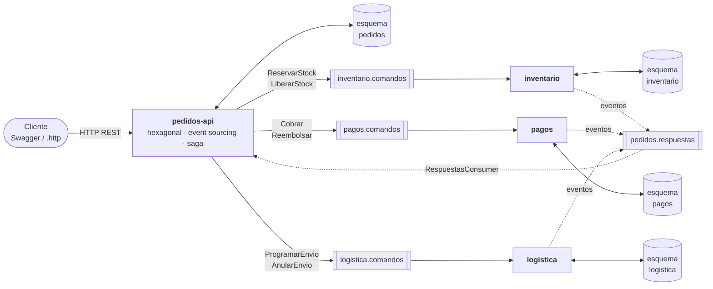
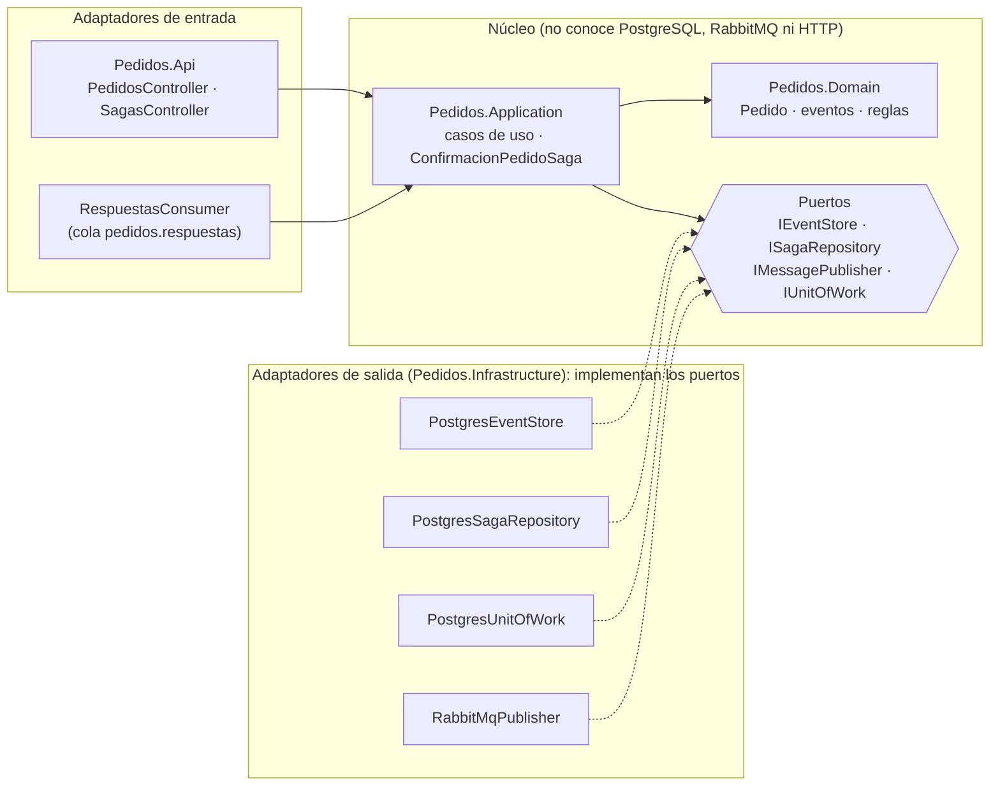
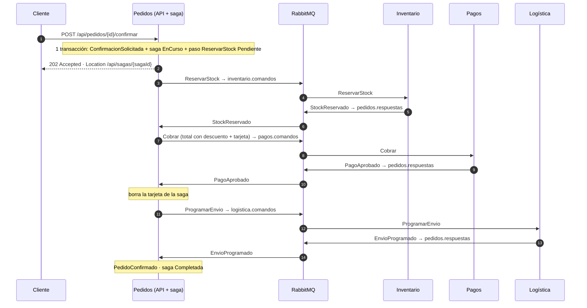
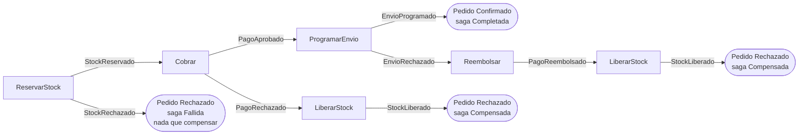
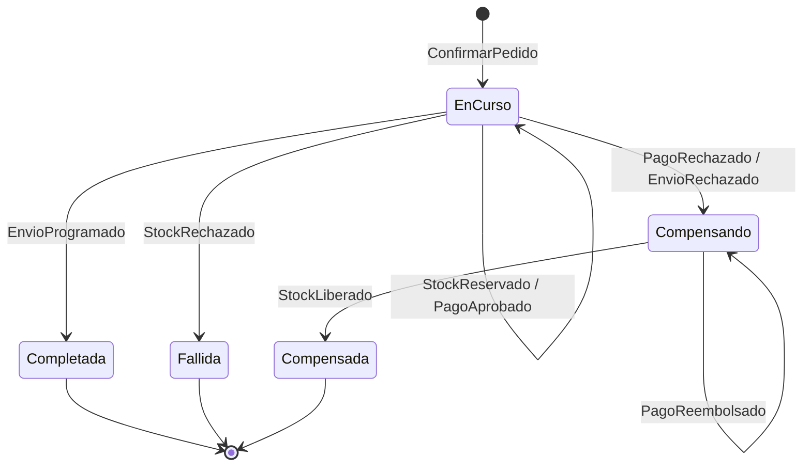
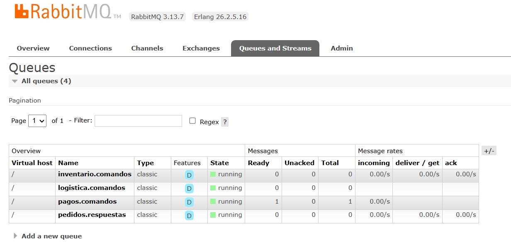
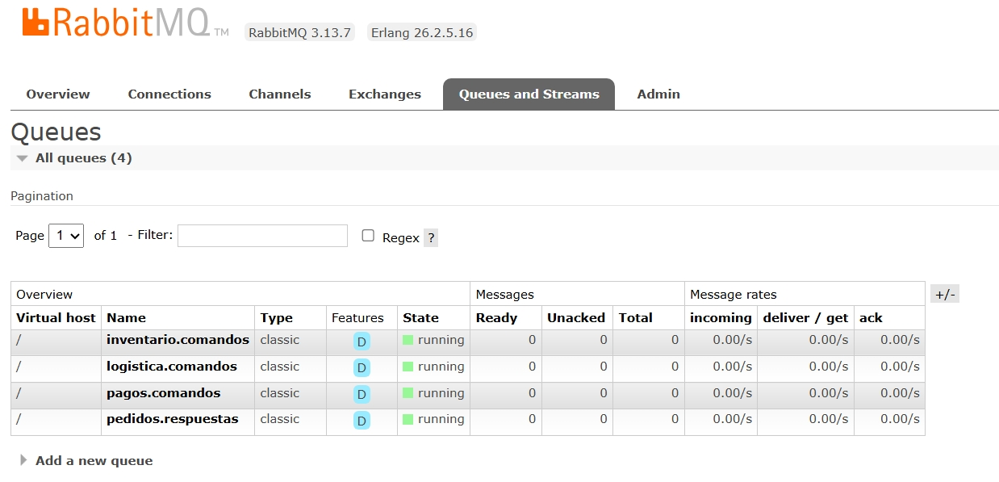

# TiendaNorte — Sistema de pedidos en .NET 10

Examen final: **arquitectura hexagonal, event sourcing, saga orquestada y colas con RabbitMQ.**

Sistema de 4 componentes (la API REST de Pedidos y los servicios de Inventario, Pagos y Logística) que confirma un pedido coordinando tres servicios que pueden fallar. Si alguno falla, la saga **deshace lo ya hecho en orden inverso** y deja el pedido en un estado consistente.

| | |
|---|---|
| **Tecnologías** | C# / .NET 10, ASP.NET Core Web API, PostgreSQL 16, RabbitMQ 3.13, xUnit |
| **Acceso a datos** | Npgsql + Dapper |
| **Mensajería** | RabbitMQ.Client 7 (API async) |
| **Pruebas** | 30 pruebas xUnit con dobles de prueba y `FakeTimeProvider` |
| **Ejecución** | Un solo comando: `docker compose up -d --build` |

## Índice

1. [Arquitectura](#1-arquitectura)
2. [Estructura de la solución](#2-estructura-de-la-solución)
3. [Dónde está cada hito](#3-dónde-está-cada-hito)
4. [Flujo de la saga](#4-flujo-de-la-saga)
5. [Instrucciones de ejecución](#5-instrucciones-de-ejecución)
6. [Ejemplos de requests](#6-ejemplos-de-requests)
7. [Escenarios de falla y compensación (E1 a E5)](#7-escenarios-de-falla-y-compensación-e1-a-e5)
8. [Modelo de datos](#8-modelo-de-datos)
9. [Mensajería](#9-mensajería)
10. [Pruebas unitarias](#10-pruebas-unitarias)
11. [Decisiones de diseño](#11-decisiones-de-diseño)
12. [Control de versiones](#12-control-de-versiones)

---

## 1. Arquitectura

El cliente opera **solo con la API de Pedidos**. Pedidos **nunca llama por HTTP** a los servicios: les deja comandos en RabbitMQ y recibe sus eventos por la cola `pedidos.respuestas`. Cada servicio guarda sus datos en **su propio esquema** de PostgreSQL y ninguno puede leer las tablas de otro.



Las 4 colas cuelgan del exchange `tiendanorte` (direct, durable). Los 4 esquemas están en el mismo servidor PostgreSQL, y cada servicio se conecta con su propio usuario.

### Interior de `pedidos-api`: el hexágono



**Arquitectura hexagonal (puertos y adaptadores).** El núcleo de Pedidos (`Domain` y `Application`) no conoce PostgreSQL, RabbitMQ ni HTTP. `Application` define **puertos** (interfaces) y `Infrastructure` los implementa con **adaptadores**. Las dependencias apuntan siempre hacia adentro:

| Proyecto | Rol | Referencia a |
|---|---|---|
| `Pedidos.Domain` | Centro del hexágono: agregado `Pedido`, eventos, reglas y excepciones de dominio | **Nada** |
| `Pedidos.Application` | Casos de uso, puertos (`IEventStore`, `ISagaRepository`, `IMessagePublisher`, `IUnitOfWork`) y `ConfirmacionPedidoSaga` | Domain, Contracts |
| `Pedidos.Infrastructure` | Adaptadores de salida (`PostgresEventStore`, `PostgresSagaRepository`, `PostgresUnitOfWork`, `RabbitMqPublisher`) y de entrada (`RespuestasConsumer`) | Application |
| `Pedidos.Api` | Adaptador de entrada HTTP (`PedidosController`, `SagasController`, `ManejadorDeErrores`) e inyección de dependencias | Application, Infrastructure |
| `TiendaNorte.Contracts` | Records de comandos y eventos compartidos por los 4 componentes | Nada |
| `Inventario.Service`, `Pagos.Service`, `Logistica.Service` | Servicios simples; sus handlers dependen de interfaces de repositorio y publicador | Contracts |

---

## 2. Estructura de la solución

La solución respeta el esqueleto del Hito 1 con los mismos nombres de proyectos y clases:

```
TiendaNorte.sln
├─ src/
│  ├─ TiendaNorte.Contracts       // Mensaje<T> (sobre común), comandos, eventos, motivos y topología de RabbitMQ
│  ├─ Pedidos.Domain              // Pedido, Eventos/, Excepciones/
│  ├─ Pedidos.Application         // CasosDeUso/, Puertos/, Sagas/ (ConfirmacionPedidoSaga), Excepciones/
│  ├─ Pedidos.Infrastructure      // Persistencia/ (Npgsql + Dapper), Mensajeria/ (RabbitMQ.Client)
│  ├─ Pedidos.Api                 // Controllers/, Errores/ (ManejadorDeErrores), Modelos/ (requests y responses)
│  ├─ Inventario.Service          // Abstracciones/, Handlers/, Datos/, Mensajeria/, Program.cs (Minimal APIs)
│  ├─ Pagos.Service               // ídem + Reglas/ (ValidadorDePago)
│  └─ Logistica.Service           // ídem + Reglas/ (CalendarioHabil, OpcionesLogistica)
├─ tests/
│  └─ TiendaNorte.UnitTests       // Dominio/ (A), Saga/ (B), Servicios/ (C), Dobles/
├─ database/init/                 // Scripts SQL: 4 esquemas, roles, tablas, secuencias y datos iniciales
├─ scripts/escenarios.ps1         // Ejecuta y verifica E1 a E5, y genera las evidencias
├─ docs/evidencias/               // Respuestas de los endpoints 5 y 6 y capturas del panel de RabbitMQ
└─ docker-compose.yml             // postgres, rabbitmq, pedidos-api, inventario, pagos, logistica
```

---

## 3. Dónde está cada hito

| Hito | Qué pide | Dónde está | Pull requests |
|---|---|---|---|
| **1. Arquitectura hexagonal** | Domain sin dependencias, puertos, adaptadores, controllers sin lógica | `Pedidos.*`, `TiendaNorte.Contracts`, `*/Abstracciones` | #1 (esqueleto y puertos), #4 (adaptadores PostgreSQL y API), #5 (`RabbitMqPublisher`), #6 (`RespuestasConsumer`) |
| **2. Event Sourcing** | El pedido son sus eventos; `Apply` por evento y `Rehidratar` | `Pedidos.Domain/Pedido.cs`, `Eventos/`, `PostgresEventStore` | #2, #4 |
| **3. Saga para la recuperación** | Saga orquestada a mano, compensaciones en orden inverso, estado en PostgreSQL | `Pedidos.Application/Sagas/ConfirmacionPedidoSaga.cs`, `RespuestasConsumer` | #6 |
| **4. PostgreSQL** | Un esquema por servicio, tablas de mensajes procesados, conexión fuera del código | `database/init/`, `appsettings.json`, `docker-compose.yml` | #3 |
| **5. Pruebas unitarias** | xUnit, mínimo 16, sin infraestructura, `FakeTimeProvider` | `tests/TiendaNorte.UnitTests` (30 pruebas) | #2 (grupo A), #8 (grupos B y C) |
| **6. Colas y eventos con RabbitMQ** | Colas durables, ack manual, idempotencia, mensajes en JSON camelCase | `*/Mensajeria/`, `TiendaNorte.Contracts` | #5 |

| Entregable | Dónde está |
|---|---|
| 1. Código fuente (`.sln`) | `TiendaNorte.sln` |
| 2. `docker-compose.yml` con los 6 servicios y un solo comando | `docker-compose.yml`, `src/*/Dockerfile` (PR #7) |
| 3. Scripts SQL de los 4 esquemas | `database/init/00` a `04` |
| 4. Pruebas con `dotnet test` sin dependencias externas | `tests/TiendaNorte.UnitTests` |
| 5. README | Este archivo |
| 6. Historial de commits | Una rama por etapa, integradas a `main` con pull request ([sección 12](#12-control-de-versiones)) |

---

## 4. Flujo de la saga

### Camino feliz (E1)

`POST /confirmar` responde **202 sin esperar**. El resultado llega después, a medida que cada servicio responde por `pedidos.respuestas`.



### Compensaciones en orden inverso

Si un paso falla, se deshacen **los pasos ya completados, empezando por el último**:



### Estados de la saga



### Tabla de decisiones de `ConfirmacionPedidoSaga`

| Evento recibido | Actualiza la saga | Paso que se marca | Evento del pedido | Comando que publica |
|---|---|---|---|---|
| `StockReservado` | guarda `reservaId`; `paso_actual = Cobrar` | ReservarStock → Completado | — | `Cobrar` a `pagos.comandos` |
| `StockRechazado` | `estado = Fallida`, `error = motivo` | ReservarStock → Fallido | `PedidoRechazado` | ninguno |
| `PagoAprobado` | borra la tarjeta; guarda `pagoId` y `codigoAutorizacion` | Cobrar → Completado | — | `ProgramarEnvio` a `logistica.comandos` |
| `PagoRechazado` | borra la tarjeta; `estado = Compensando` | Cobrar → Fallido | — | `LiberarStock` a `inventario.comandos` |
| `EnvioProgramado` | `estado = Completada` | ProgramarEnvio → Completado | `PedidoConfirmado` | ninguno |
| `EnvioRechazado` | `estado = Compensando`, `paso_actual = Reembolsar` | ProgramarEnvio → Fallido | — | `Reembolsar` a `pagos.comandos` |
| `PagoReembolsado` | `paso_actual = LiberarStock` | Reembolsar → Completado | — | `LiberarStock` a `inventario.comandos` |
| `StockLiberado` | `estado = Compensada` | LiberarStock → Completado | `PedidoRechazado` (motivo guardado en `error`) | ninguno |

Ante cada evento, la saga guarda **en una sola transacción** la saga, sus pasos, el evento del pedido (si corresponde) y el `messageId` procesado. **Recién después del commit** publica el comando siguiente.

---

## 5. Instrucciones de ejecución

### Requisitos

- [Docker Desktop](https://www.docker.com/products/docker-desktop/)
- [.NET 10 SDK](https://dotnet.microsoft.com/download/dotnet/10.0), solo para correr las pruebas o los servicios fuera de Docker

### Levantar todo con un solo comando

```bash
docker compose up -d --build
```

La primera vez descarga las imágenes y compila los 4 componentes (unos minutos). Los componentes .NET arrancan recién cuando `postgres` y `rabbitmq` están `healthy`.

| Servicio | Dirección | Credenciales |
|---|---|---|
| `pedidos-api` (Swagger) | http://localhost:5070/swagger | — |
| `inventario` | http://localhost:5172/api/productos | — |
| `pagos` | http://localhost:5149/api/pagos?pedidoId={id} | — |
| `logistica` | http://localhost:5250/api/envios?fecha=AAAA-MM-DD | — |
| `rabbitmq` (panel de administración) | http://localhost:15672 | `tiendanorte` / `tiendanorte_dev` |
| `postgres` | `localhost:5433`, base `tiendanorte` | `postgres` / `postgres_dev` |

PostgreSQL se publica en el puerto **5433** para no chocar con una instalación local en el 5432. Dentro de Docker los servicios usan `Host=postgres;Port=5432`.

### Comandos útiles

```bash
docker compose ps                       # estado de los 6 servicios
docker compose logs -f pedidos-api      # logs de la saga
docker compose stop                     # detener sin perder datos
docker compose down -v                  # borrar todo, incluidos los datos (se recrean al levantar)
```

### Pruebas unitarias

```bash
dotnet test
```

Resultado esperado: **30 correctas y 0 erróneas**, sin PostgreSQL, RabbitMQ ni HTTP.

> **Nota para Windows 11:** si el *Control inteligente de aplicaciones* está activado, puede bloquear la DLL de pruebas recién compilada porque no está firmada (`FileLoadException ... 0x800711C7`). En ese caso, las pruebas se pueden correr dentro de Docker con la imagen del SDK, sin tocar la configuración de seguridad:
>
> ```powershell
> docker run --rm -v "${PWD}:/src:ro" mcr.microsoft.com/dotnet/sdk:10.0 sh -c "cp -r /src /work && cd /work && rm -rf src/*/bin src/*/obj tests/*/bin tests/*/obj && dotnet test"
> ```

### Ejecutar los servicios fuera de Docker (opcional)

```bash
docker compose up -d postgres rabbitmq
dotnet run --project src/Inventario.Service
dotnet run --project src/Pagos.Service
dotnet run --project src/Logistica.Service
dotnet run --project src/Pedidos.Api
```

Cada proyecto lee su cadena de conexión y la conexión a RabbitMQ de su `appsettings.json`.

---

## 6. Ejemplos de requests

Los requests listos para ejecutar están en archivos `.http` (extensión *REST Client* de VS Code o Visual Studio):

| Archivo | Contenido |
|---|---|
| [`src/Pedidos.Api/Pedidos.Api.http`](src/Pedidos.Api/Pedidos.Api.http) | Los 6 endpoints de Pedidos, incluidos casos de error (400, 404, 409, 422) |
| [`src/Inventario.Service/Inventario.Service.http`](src/Inventario.Service/Inventario.Service.http) | Productos, stock y reservas |
| [`src/Pagos.Service/Pagos.Service.http`](src/Pagos.Service/Pagos.Service.http) | Pagos por id y por pedido |
| [`src/Logistica.Service/Logistica.Service.http`](src/Logistica.Service/Logistica.Service.http) | Envíos por id y por fecha |

### Los 6 endpoints de la API de Pedidos

| # | Endpoint | Respuesta |
|---|---|---|
| 1 | `POST /api/pedidos` | 201, `Location: /api/pedidos/{pedidoId}` |
| 2 | `POST /api/pedidos/{pedidoId}/items` | 200 con el pedido actualizado |
| 3 | `POST /api/pedidos/{pedidoId}/confirmar` | 202, `Location: /api/sagas/{sagaId}` |
| 4 | `GET /api/pedidos/{pedidoId}` | 200, reconstruido desde sus eventos |
| 5 | `GET /api/pedidos/{pedidoId}/eventos` | 200, los eventos guardados |
| 6 | `GET /api/sagas/{sagaId}` | 200, la saga y sus pasos (sin datos de tarjeta) |

```http
### 1. Crear pedido
POST http://localhost:5070/api/pedidos
Content-Type: application/json

{ "clienteId": "CLI-001", "direccionEnvio": { "calle": "Av. Mate de Luna", "numero": "1234", "ciudad": "San Miguel de Tucumán", "codigoPostal": "4000" } }

### 2. Agregar ítem
POST http://localhost:5070/api/pedidos/{pedidoId}/items
Content-Type: application/json

{ "productoId": "P001", "cantidad": 2, "precioUnitario": 45000 }

### 3. Confirmar (inicia la saga)
POST http://localhost:5070/api/pedidos/{pedidoId}/confirmar
Content-Type: application/json

{ "tarjeta": { "numero": "4111111111111111", "titular": "Juan Perez", "vencimiento": "12/28" }, "fechaEnvioPreferida": "2026-11-25" }
```

Los errores se devuelven en formato `ProblemDetails`:

| Código | Cuándo | Ejemplo de `type` |
|---|---|---|
| 400 | El body no cumple las validaciones de formato (detalle por campo en `errors`) | — |
| 404 | El pedido o la saga no existe | `https://tiendanorte/errores/no-encontrado` |
| 409 | Operación no permitida en el estado actual, o conflicto de versión | `https://tiendanorte/errores/estado-invalido` |
| 422 | Se viola una regla de negocio (por ejemplo, confirmar sin ítems) | `https://tiendanorte/errores/regla-de-negocio` |

---

## 7. Escenarios de falla y compensación (E1 a E5)

Los 5 escenarios se ejecutaron y verificaron con el script [`scripts/escenarios.ps1`](scripts/escenarios.ps1), sobre el sistema en Docker recreado desde cero. El script opera solo a través de la API de Pedidos, como el cliente, y usa los `GET` de los 3 servicios para verificar que cada compensación tuvo efecto real.

```powershell
powershell -ExecutionPolicy Bypass -File .\scripts\escenarios.ps1 -Reiniciar
```

**Resultado: las 29 verificaciones dieron OK** ([resumen completo](docs/evidencias/resumen.md)).

| # | Escenario | Pasos que llegan a completarse | Compensaciones (en orden) | Estado final del pedido |
|---|---|---|---|---|
| E1 | Todo funciona | Stock, Pago, Envío | Ninguna | `Confirmado` |
| E2 | Falla Inventario (sin stock) | Ninguno | Ninguna | `Rechazado` |
| E3 | Falla Pagos (tarjeta rechazada) | Stock | LiberarStock | `Rechazado` |
| E4 | Falla Logística (sin cupo) | Stock, Pago | Reembolsar → LiberarStock | `Rechazado` |
| E5 | Pagos apagado al confirmar | Stock; `Cobrar` queda en la cola | Ninguna | `PendienteConfirmacion` → `Confirmado` al levantar Pagos |

Las respuestas completas de los endpoints 4, 5 y 6 de cada escenario, con el estado de las colas, están en [`docs/evidencias/`](docs/evidencias/).

### E1 — Todo funciona

**Requests:** pedido con 2 × P001 ($45.000 c/u), tarjeta `4111111111111111`, `fechaEnvioPreferida: 2026-11-25`.

**Endpoint 5 (eventos del pedido):**

| Versión | Tipo | Datos |
|---|---|---|
| 1 | `PedidoCreado` | `clienteId: CLI-001`, dirección |
| 2 | `ItemAgregado` | `P001 × 2 a 45000` |
| 3 | `ConfirmacionSolicitada` | `sagaId: cec76a10-...` |
| 4 | `PedidoConfirmado` | `codigoAutorizacion: GR9DCF`, `codigoSeguimiento: TN-000001`, `fechaEstimadaEntrega: 2026-11-30` |

**Endpoint 6 (saga `Completada`):**

| Paso | Estado | Resultado |
|---|---|---|
| ReservarStock | Completado | `reservaId: R-000001` |
| Cobrar | Completado | `pagoId: PG-000001` |
| ProgramarEnvio | Completado | `envioId: E-000001`, `codigoSeguimiento: TN-000001` |

**Panel de RabbitMQ:** las 4 colas terminan con 0 mensajes; cada comando y cada evento fue consumido.

La entrega estimada es el **lunes 30/11**: despacho el miércoles 25 más 3 días hábiles, sin contar sábado ni domingo. Stock de P001: 10 → **8**. [Evidencia completa](docs/evidencias/E1-todo-funciona.json)

### E2 — Falla Inventario (sin stock)

**Cómo se provoca:** 3 × P005 (Notebook), que tiene stock 2.

**Endpoint 5:** `PedidoCreado` → `ItemAgregado` (P005 × 3) → `ConfirmacionSolicitada` → **`PedidoRechazado` (`STOCK_INSUFICIENTE`)**.

**Endpoint 6 (saga `Fallida`):**

| Paso | Estado | Motivo |
|---|---|---|
| ReservarStock | **Fallido** | `STOCK_INSUFICIENTE` |

Falló el primer paso, así que **no hubo nada que compensar** y no se publicó ningún comando más.

**Verificación con los GET:** stock de P005 sin cambios (2 → **2**); `GET /api/pagos?pedidoId=...` devuelve una **lista vacía**: no se intentó cobrar. [Evidencia completa](docs/evidencias/E2-falla-inventario.json)

### E3 — Falla Pagos (tarjeta rechazada)

**Cómo se provoca:** tarjeta terminada en **0000** (`4111111111110000`).

**Endpoint 5:** `PedidoCreado` → `ItemAgregado` → `ConfirmacionSolicitada` → **`PedidoRechazado` (`TARJETA_RECHAZADA`)**.

**Endpoint 6 (saga `Compensada`):**

| Paso | Estado | Resultado / motivo |
|---|---|---|
| ReservarStock | Completado | `reservaId: R-000002` |
| Cobrar | **Fallido** | `TARJETA_RECHAZADA` (`pagoId: PG-000002`) |
| LiberarStock | Completado | **compensación** |

**Verificación con los GET (la compensación tuvo efecto real):**

| Verificación | Antes | Después |
|---|---|---|
| Stock de P001 (`GET /api/productos/P001`) | 8 | **8**: volvió a su valor original |
| Pago `PG-000002` (`GET /api/pagos?pedidoId=...`) | — | **`Rechazado`**, `tarjetaUltimos4: "0000"` |
| Envíos | — | **ninguno**: el pedido nunca llegó a Logística |

[Evidencia completa](docs/evidencias/E3-falla-pagos.json)

### E4 — Falla Logística (sin cupo para la fecha)

**Cómo se provoca:** `CupoDiario = 0` en Logística. Se puede hacer de dos formas:

```powershell
# Opción 1: editar src/Logistica.Service/appsettings.json ("CupoDiario": 0) y reconstruir
docker compose up -d --build logistica

# Opción 2 (sin editar archivos): variable de entorno que lee docker-compose.yml
$env:CUPO_DIARIO = "0"; docker compose up -d logistica
# Para volver al cupo normal (3):
Remove-Item Env:CUPO_DIARIO; docker compose up -d logistica
```

**Endpoint 5:** `PedidoCreado` → `ItemAgregado` → `ConfirmacionSolicitada` → **`PedidoRechazado` (`SIN_CUPO`)**.

**Endpoint 6 (saga `Compensada`), con las compensaciones en orden inverso:**

| Paso | Estado | Resultado / motivo |
|---|---|---|
| ReservarStock | Completado | `reservaId: R-000003` |
| Cobrar | Completado | `pagoId: PG-000003` |
| ProgramarEnvio | **Fallido** | `SIN_CUPO` |
| Reembolsar | Completado | **compensación 1**: deshace el pago |
| LiberarStock | Completado | **compensación 2**: deshace la reserva |

**Verificación con los GET (la compensación tuvo efecto real):**

| Verificación | Antes | Después |
|---|---|---|
| Stock de P001 | 8 | **8**: volvió a su valor original |
| Pago `PG-000003` | `Aprobado` | **`Reembolsado`**, con `fechaReembolso` |
| Envíos del pedido en `GET /api/envios?fecha=2026-11-25` | — | **ninguno activo** (solo figura `E-000001`, de E1) |

[Evidencia completa](docs/evidencias/E4-falla-logistica.json)

### E5 — El servicio de Pagos está apagado al confirmar

**Cómo se provoca:**

```bash
docker compose stop pagos
# confirmar un pedido y verificar su estado
docker compose start pagos
```

**Con Pagos apagado:**

| Qué se consulta | Resultado |
|---|---|
| Endpoint 4 (pedido) | **`PendienteConfirmacion`** (versión 3) |
| Endpoint 6 (saga) | **`EnCurso`**: ReservarStock Completado (`R-000004`), **Cobrar Pendiente** |
| Panel de RabbitMQ | **`pagos.comandos`: 1 mensaje en *Ready***. El comando `Cobrar` espera a que Pagos vuelva |



**Al levantar Pagos:** Pagos consume el `Cobrar` que esperaba, la saga continúa con `ProgramarEnvio` y termina **`Completada`**. El pedido pasa a **`Confirmado`** (`TN-000002`, entrega estimada 2026-11-30). El endpoint 5 muestra el evento `PedidoConfirmado` como versión 4, unos 8 segundos después de la confirmación: el tiempo que estuvo apagado Pagos.



Las 4 colas tienen la marca **D** (durable): el mensaje no se pierde aunque el consumidor esté caído. [Evidencia completa](docs/evidencias/E5-pagos-apagado.json)

---

## 8. Modelo de datos

Un servidor PostgreSQL 16 con **un esquema por servicio**. Cada servicio se conecta con **su propio usuario**, dueño solo de su esquema: si Inventario intenta leer `pedidos.eventos`, PostgreSQL responde `permission denied for schema pedidos`. Así la regla *"ningún servicio lee las tablas de otro"* la hace cumplir la base.

| Esquema (usuario) | Tablas |
|---|---|
| `pedidos` (`pedidos_app`) | `eventos` (event store, `UNIQUE (stream_id, version)`), `sagas`, `saga_pasos`, `mensajes_procesados` |
| `inventario` (`inventario_app`) | `productos`, `reservas`, `reserva_items`, `mensajes_procesados` |
| `pagos` (`pagos_app`) | `pagos` (solo `tarjeta_ultimos4`, nunca el número completo), `mensajes_procesados` |
| `logistica` (`logistica_app`) | `envios`, `mensajes_procesados` |

- **No existe una tabla de pedidos:** el pedido es su lista de eventos en `pedidos.eventos` y su estado se reconstruye con `Pedido.Rehidratar(eventos)`.
- **Ids con prefijo** generados con secuencias: `R-000001`, `PG-000001`, `E-000001` / `TN-000001` (envío y seguimiento comparten número).
- **Datos iniciales** de Inventario (P001 a P005) cargados al arrancar con `ON CONFLICT DO NOTHING`, para no pisar el stock en un reinicio.
- Los scripts de [`database/init/`](database/init/) se ejecutan solos la primera vez que arranca PostgreSQL (volumen vacío).
- Las cadenas de conexión están en `appsettings.json` y, en Docker, en variables de entorno. Nunca en el código.

---

## 9. Mensajería

| Elemento | Valor |
|---|---|
| Exchange | `tiendanorte` (direct, durable) |
| Colas de comandos | `inventario.comandos`, `pagos.comandos`, `logistica.comandos` (routing key = nombre de la cola) |
| Cola de respuestas | `pedidos.respuestas`: todos los eventos de los 3 servicios |
| Formato | Sobre JSON en camelCase: `{ messageId, sagaId, pedidoId, tipo, fechaUtc, datos }` (`Mensaje<T>` en `TiendaNorte.Contracts`) |
| Correlación | La respuesta copia `sagaId` y `pedidoId` del comando y genera un `messageId` nuevo |

Cada consumidor usa `BasicQosAsync(prefetchCount: 1)` y `autoAck: false`:

| Situación | Qué hace el consumidor |
|---|---|
| Procesado correctamente o **rechazo de negocio** (sin stock, tarjeta rechazada, sin cupo) | Publica el evento con su `motivo` y hace `ack` |
| **Error técnico** (base caída, excepción inesperada) | Rollback y `BasicNackAsync(requeue: true)`: el mensaje se reintenta |
| **Mensaje mal formado** (JSON inválido o `tipo` desconocido) | Lo registra en el log y hace `ack` para descartarlo |
| **Mensaje repetido** (`messageId` ya en `mensajes_procesados`) | No repite la acción y hace `ack` (idempotencia) |

- El `messageId` se registra **en la misma transacción** que el cambio de datos.
- **Las compensaciones siempre terminan bien**: si no hay nada que compensar, igual publican su evento para que la saga pueda terminar.
- **Todos los componentes declaran el exchange y las 4 colas al arrancar.** Así un comando nunca se pierde aunque su servicio todavía no haya levantado (E5).
- Los servicios leen con `SELECT ... FOR UPDATE` para que dos mensajes no modifiquen a la vez el mismo stock, pago o envío.

---

## 10. Pruebas unitarias

**30 pruebas xUnit** (mínimo exigido: 16). Usan estructura *Arrange / Act / Assert*, nombres con el patrón `Metodo_Escenario_ResultadoEsperado` y **dobles de prueba propios** en lugar de PostgreSQL, RabbitMQ y HTTP. Las reglas que dependen de la fecha (vencimiento de la tarjeta, días hábiles) usan `FakeTimeProvider`.

| Grupo | Pruebas | Archivo | Qué cubre |
|---|---|---|---|
| A. Agregado y event sourcing | 10 | `Dominio/PedidoTests.cs` | `PedidoCreado`, cantidad 0 u 11, ítem en pedido confirmado, descuento por encima de $100.000 y no en $100.000 exactos, confirmar sin ítems, rehidratar = ejecutar comandos |
| B. Saga de confirmación | 8 | `Saga/ConfirmacionPedidoSagaTests.cs` | `ReservarStock` con `SagaId` y luego `Cobrar`; `StockRechazado` sin más comandos; `PagoRechazado` → `LiberarStock` sin `ProgramarEnvio`; `ProgramarEnvio` solo tras `PagoAprobado`; **`Reembolsar` antes que `LiberarStock`**; la saga se guarda con cada evento |
| C. Handlers de los servicios | 12 | `Servicios/*HandlersTests.cs` | Sin stock y stock sin cambios; tarjeta 0000; cupo completo; **idempotencia por `MessageId`**; producto inexistente; tarjeta vencida; orden de las reglas; sábado; dirección incompleta; días hábiles |

```
Passed!  - Failed: 0, Passed: 30, Skipped: 0, Total: 30
```

---

## 11. Decisiones de diseño

| Decisión | Motivo |
|---|---|
| Un usuario de PostgreSQL por servicio | La base hace cumplir que ningún servicio lea tablas de otro |
| `PedidoId`, `Version` y `FechaUtc` son metadatos del evento | Van en las columnas `stream_id`, `version` y `fecha_utc`; la columna `datos` lleva solo el contenido, como en el ejemplo del endpoint 5 |
| El mismo producto agregado dos veces queda en dos líneas | Cada `ItemAgregado` es una línea; el máximo de 10 se aplica sobre la suma, e Inventario recibe una línea por producto |
| Npgsql + Dapper en lugar de EF Core | El enunciado describe cada paso con SQL explícito; Dapper ejecuta ese SQL tal cual |
| Dobles de prueba propios en lugar de Moq | Permiten verificar secuencias, como el orden de los comandos de compensación, de forma legible y sin dependencias extra |
| Un evento que no corresponde al paso pendiente se ignora | Protege la saga de eventos repetidos o fuera de orden |
| Si `Confirmar` o `Rechazar` lanzan `EstadoInvalidoException` en el consumidor, se hace `ack` | No es un error técnico: reencolarlo lo haría fallar para siempre |
| Se publica después del commit (sin Outbox) | Lo acepta el enunciado. La mejora posible es el patrón Outbox: guardar el comando en la base dentro de la misma transacción y publicarlo después |
| Las ramas no siguen el número de los hitos | Cada pieza se construyó cuando ya existía aquello de lo que depende (la saga, al final). El Hito 1 se integró en dos pull requests: puertos y adaptadores |
| RabbitMQ en lugar de Kafka | Es la tecnología indicada por el enunciado |

---

## 12. Control de versiones

Cada etapa se desarrolló en su propia rama y se integró a `main` mediante pull request, con commits chicos en formato *Conventional Commits* (`feat:`, `fix:`, `test:`, `build:`, `docs:`, `chore:`).

| PR | Rama | Contenido |
|---|---|---|
| #1 | `feature/hexagonal` | Hito 1: esqueleto de la solución, contratos y puertos |
| #2 | `feature/event-sourcing` | Hito 2: agregado `Pedido`, eventos y pruebas del grupo A |
| #3 | `feature/postgres` | Hito 4: PostgreSQL, esquemas, roles, tablas y datos iniciales |
| #4 | `feature/hexagonal-adaptadores` | Hito 1: adaptadores PostgreSQL, casos de uso y API REST |
| #5 | `feature/rabbitmq` | Hito 6: RabbitMQ, endpoint 3 y los 3 servicios |
| #6 | `feature/saga` | Hito 3: saga para la recuperación y consumidor de respuestas |
| #7 | `feature/docker` | Entregable 2: los 6 servicios en `docker-compose.yml` y escenario E5 |
| #8 | `feature/unit-tests` | Hito 5: pruebas de los grupos B y C (30 en total) |
| #9 | `docs/readme` | README, script de escenarios y evidencias de E1 a E5 |
